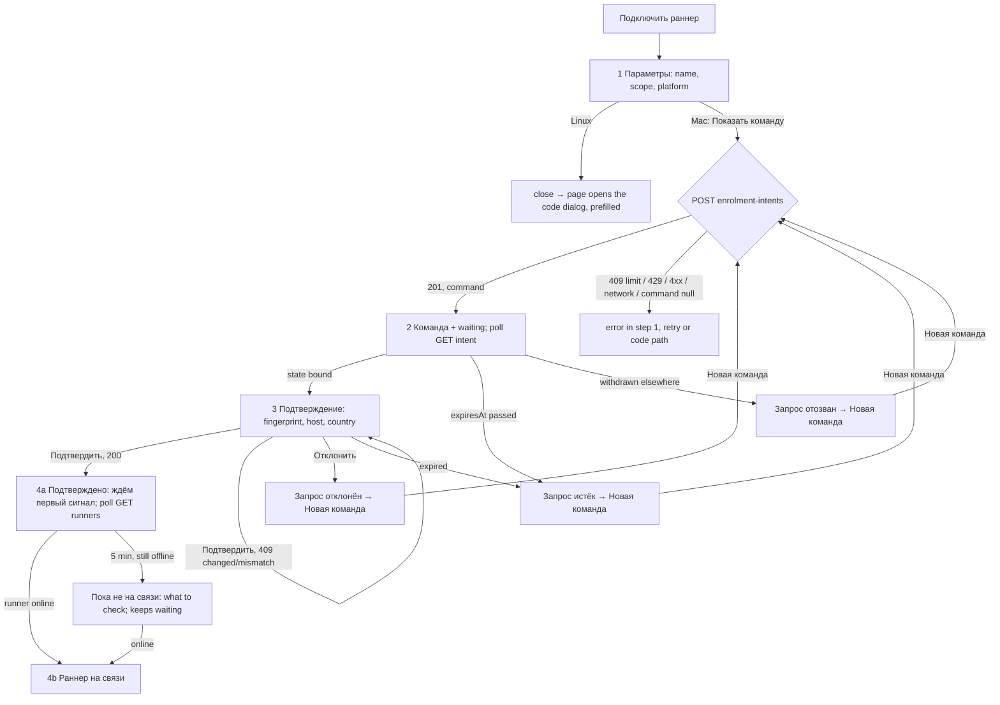

# UX spec — #634 PR 4: Settings › Runners › Add runner (the wizard)

Low-fidelity wireframe: [634-add-runner-wizard.html](634-add-runner-wizard.html). It covers every state in §6;
the demo bar switches state, iPhone / Mac, the number of owners and whether the release ships `node`.

Read: #634 (architect note §2 and §6, PR split §9, security note S1–S5, R-INT-1…7, R-ONE-1, R-PKG-1…3, the PR 4
acceptance list, owner decisions D1–D5 of 2026-11-17), `libs/shared/contracts/src/lib/enrolment-intent.ts` and
`apps/api/src/routes/enrolment-intents.ts` (PR 3, on `dev`), `features/enrol-runner` (the code dialog),
`entities/runner` (`RunnerScopePicker`, `runnerFailureKeyOf`, the store), `pages/settings/…/runners.page.html`,
`docs/runbooks/runner.md` › «One command: `setup`», the #759 UX spec for format.

## 0. Decisions, with reasons

1. **The wizard replaces «Подключить раннер» for a Mac; the code dialog stays for everything else.** Both buttons on
   Settings › Runners (header and empty state) open the wizard. Choosing Linux in step 1 hands over to today's
   enrolment-code dialog, unchanged (§3.1). Reason: PR 7 (Linux one command) is later, and the code path works for
   Linux today. FSD: the wizard is a new slice `features/add-runner`. It never imports `features/enrol-runner`: it
   closes with `{ next: 'code', name, projectScope, allowedProjects }` and `pages/settings` opens the code dialog
   with those values prefilled. The polling model sits in `entities/runner`.
2. **A sheet, not a route.** The same `Sheet` as the code dialog: a wide dialog on Mac, a full-height bottom sheet on
   iPhone. Reason: R-INT-2 and the AC say the intent id must not sit in a URL. A route would want it in the path to
   survive a reload. The intent lives in the sheet's memory only. Closing the sheet while the request is still open
   withdraws it (§3.6), so nothing is left behind.
3. **Four steps:** **Параметры → Команда → Подтверждение → На связи.** Step 4 has two phases: waiting for the
   first signal, then on line. The architect's states (0)–(4) map onto them. The step indicator is text («Шаг 2 из 4 ·
   Команда»), plus a short `ol` on Mac. It is not a tab list: steps are not navigable, the flow moves on by itself.
4. **The one-liner is offered only when the release ships `node` (S2).** Otherwise the command step shows the
   runbook path: install by hand, then the `setup` command. The client never decides this from its own state. It
   renders the one-liner only when the API returns one (§3.2, contract note N1).
5. **Bound host fields are text, and the fingerprint is the only identity.** Hostname, OS, arch, version, backend and
   bind country are plain text in a ledger, inside `<bdi dir="auto">` (R-INT-7). The fingerprint is the big element.
   Approve sends the fingerprint that was displayed (CAS, already in the API).
6. **«Подтвердить» is never the default action.** Nothing is autofocused on step 3, Enter in the sheet does not
   approve, and «Отклонить» comes first in the reading order. Reason: approval is the one security decision in the
   flow. A habit-click must not do it.
7. **The multi-owner sentence follows D3 («no»).** Under «Все проекты аккаунта», a subscription-signed runner serves
   only the enrolling owner's projects. When the account has more than one owner, the sentence that says so is always
   shown under the radio, not only in a hint that can be skipped. It is also shown while the owner count is unknown
   (members failed to load), so the safe text wins (§3.1).

## 1. Job and entry points

**Job.** «Я хочу, чтобы команда выполняла задания на моём Mac. Дайте одну команду, которую я вставлю в Терминал, и
скажите, когда всё заработало, без кодов и ручных файлов.»
**Who.** The account owner (`owner` role). A member never sees the entry (the page shows `runners.forbidden.*`).

**Entry points**
1. Settings › Runners › «Подключить раннер» (`runners-enrol`, header, when the account has runners).
2. Settings › Runners, empty state › «Подключить раннер».
3. Later (PR 6): the `.pkg` deep link opens the helper, not this wizard. No change here.

## 2. Flow



«Новая команда» keeps the name, scope and platform. It creates a new intent and lands on step 2. The old intent is
already expired or withdrawn.

**Polling** (owner's GETs, in `entities/runner`):
- Steps 2–3: `GET …/enrolment-intents/:id` every 3 s while the page is visible and every 15 s while it is hidden.
  Poll once at once on `visibilitychange` → visible and on the `online` event. Stop on `approved | used | expired |
  withdrawn`.
- Step 4: `GET …/runners` every 5 s (same visibility rule) until the row with `runnerId` has `online: true`.
- The countdown is computed from `expiresAt` and is display only. At local expiry, one GET confirms. The server's
  `state` always wins.
- No request ever has the intent id in a query string (AC). It is in the path of the owner's own API calls only.

## 3. Steps

### 3.1 Step 1 «Параметры»
Fields, in order:
1. **Название** (reuses `runners.enrol.name`, `nameHint`, `nameEmpty`; `RUNNER_NAME_MAX_LENGTH`).
2. **Какие проекты обслуживает раннер**: `RunnerScopePicker`, as is. «Все проекты аккаунта» is preselected.
   - Under «Все проекты аккаунта»: `runners.scope.allHint` (shortened, §8) says what it means: every current and
     future project of the account.
   - **Multi-owner sentence** `runners.scope.allOwners`, a visible paragraph under the hint (not hidden behind a
     disclosure). It is shown when `GET /accounts/:id/members` counts more than one `owner`, or when that call has
     not answered or has failed. It is hidden only when exactly one owner is known.
   - Under «Только выбранные» with no project ticked: the existing `runners.enrol.noProjects` line as a warning. It
     does not block: a runner with no projects is allowed.
3. **Где будет работать раннер** (`ChoiceGroup`, two radios):
   - **Mac** (preselected): hint «Отдельный пользователь macOS: задания не видят ваших файлов. Понадобится пароль
     администратора.» Below it is a quiet line «Изоляция: отдельный пользователь macOS» (backend `user`, fixed).
   - **Linux или Docker**: hint «Пока подключается по одноразовому коду. Одна команда для Linux появится позже.»
   - Under the group, a quiet line: «Позже: установщик .pkg для Mac, без Терминала.» It is text, not a disabled
     radio (owner decision 2).

Footer: primary **«Показать команду»** (Mac) or **«Получить код»** (Linux → hands over, decision 1), secondary
«Отмена». Busy: «Готовим команду…», with the button `aria-disabled` (the code dialog's pattern) and the fields
read-only.

Errors (banner `tone="danger"`, `role="alert"`, under the form; the primary button becomes «Повторить»):

| Answer | Copy key | Extra action |
|---|---|---|
| 409 `enrolment-intent-limit` | `runners.wizard.err.limit` | none |
| 429 `rate-limited` (hourly) | `runners.wizard.err.hourly` | none |
| 201 with `command: null` (origin not configured) | `runners.wizard.err.noCommand` | link «Подключить по коду» → hands over (decision 1) |
| 422 `allowed-projects-invalid` | `runners.err.allowedProjects` (reused) | none |
| 422 other / `enrolment-intent-invalid` | `runners.err.invalid` (reused) | none |
| 403 forbidden / suspended | `runners.err.forbidden` / `runners.wizard.err.suspended` | none |
| offline, timeout, 5xx, 401 | `runners.err.offline` / `.timeout` / `.error` / `.sessionExpired` (reused via `runnerFailureKeyOf`) | none |

### 3.2 Step 2 «Команда» (intent `pending`)
Heading h3 (focused on arrival): «Выполните команду в Терминале на машине «{name}»».

**Variant A: one-liner** (the API returned the install command, N1):
- Lead: «Откройте Терминал на этом Mac, вставьте команду и нажмите Return. macOS спросит пароль администратора: он
  нужен для sudo.»
- Arch (`Segmented`, legend «Процессор Mac»): «Apple silicon (M1 и новее)» | «Intel». Hint: «Не знаете какой? Меню
  Apple → «Об этом Mac»: строка «Чип» значит Apple silicon, строка «Процессор» значит Intel.» Switching it swaps the
  command text. It does not create a new intent (N2).
- `CopyCode` with the command from the API, byte for byte.
- Disclosure «Что делает команда»: «Скачивает выпуск {version} с GitHub во временную папку, сверяет его контрольную
  сумму с той, что показывает консоль, и только потом распаковывает и запускает установку. Установка создаёт для
  раннера отдельных пользователей macOS, просит вас войти в Claude в браузере и запускает службу.»

**Variant B: runbook path** (no one-liner: the release does not list `node` in `SHA256SUMS`, or it is not
configured):
- Lead: «Этот выпуск раннера пока не ставится одной командой. Сначала установите его по инструкции, затем выполните
  команду ниже.»
- Numbered list:
  1. «Скачайте и проверьте выпуск {version}.» Link «Инструкция: установка раннера ↗» → the runbook section «Get a
     release and verify it» (N3).
  2. «Выполните в Терминале:» then `CopyCode` with the `setup` command from the API.

**Both variants:**
- Line under the code: «В команде нет секретов: только адрес консоли и номер запроса. Она подходит для одной
  машины.»
- Expiry line: «Запрос действует до {time}, осталось {minutes} мин.» It updates once a minute and is not a live
  region. One polite announcement at 1 minute left: «Запрос истекает через минуту.»
- Waiting row: `Spinner` + «Ждём запрос с вашей машины…» and the sub-line «Когда команда дойдёт до подключения,
  здесь появится код для сверки.»
- **iPhone:** a callout above the command, tone neutral: «Команду выполняют в Терминале на Mac. Удобнее начать
  прямо на нём: откройте там Настройки › Раннеры. Или скопируйте команду и перешлите себе. Подтвердить запрос
  можно и отсюда.» The copy button stays (owner decision 3).
- Footer: secondary «Отозвать запрос» (withdraw → back to step 1 with the values kept, announce «Запрос отозван»).
  Close (×) follows §3.6.

### 3.3 Step 3 «Подтверждение» (intent `bound`)
Heading h3 (focused on arrival): «Машина просит подключения».
- Callout tone warning, title **«Сверьте с терминалом»**, body: «Терминал напечатал код машины. Подтверждайте,
  только если он совпадает с кодом ниже и это ваша машина.»
- **Код машины**: the fingerprint `ABCD-EFGH` in mono, large (28 px phone / 32 px Mac), `aria-label` spelled out by
  characters («A B C D, дефис, E F G H»), so a screen reader reads it the way it is compared.
- Ledger (`tc-ledger`), every value text-only in `<bdi dir="auto">`, long values wrap (`overflow-wrap: anywhere`):
  - «Машина»: `host.hostname`
  - «Система»: `{os} · {arch}`
  - «Версия раннера»: `version`
  - «Изоляция»: `runners.backend.{isolation}`
  - «Откуда запрос»: country name from `boundCountry` via `Intl.DisplayNames` in the UI language, plus the code
    («Германия (DE)»). `null` → «страна не определена».
  - «Запрос получен»: `boundAt` as local time.
- Disclosure (closed): «Терминал пишет, что запрос уже занят другой машиной?» Body: «Значит, другая машина
  перехватила этот запрос раньше вашей. Нажмите «Отклонить» и начните заново. Ту машину подключать нельзя.» This is
  the 409 `enrolment-intent-bound` line the real `setup` prints (security Q1).
- The expiry line from step 2.
- Footer, in this DOM order: **«Отклонить»** (danger, secondary), **«Подтвердить»** (primary). Nothing is
  autofocused (decision 6). Busy: «Подтверждаем…» / «Отклоняем…»; the other button is `aria-disabled`.

Approve outcomes (`POST …/approve {fingerprint: <displayed>}`):

| Answer | What shows |
|---|---|
| 200 (`approved`) | step 4a |
| 409 `enrolment-fingerprint-mismatch` or `enrolment-intent-changed` | GET again, re-render step 3 with the new values, banner `role="alert"` `runners.wizard.err.changed`. Focus to the heading. Never auto-approve. |
| 409 `enrolment-intent-not-bound` | GET again (it should not happen) and render the state it is in |
| 404 `enrolment-not-found` | GET again. If expired → «Запрос истёк». Otherwise → «Запрос отозван». |
| 403 `account-suspended` | banner `runners.wizard.err.suspended`; buttons stay, «Подтвердить» `aria-disabled` |
| 422 (`none` in production) | banner `runners.err.invalid` (not reachable from a Mac `user` intent) |
| offline / timeout / 5xx | banner with `runners.err.offline` / `.timeout` / `.error`; the step stays as it was, «Подтвердить» works again |

Reject = `POST …/withdraw` → the «Запрос отклонён» state (§6). There is no extra confirm: nothing is lost, and the
next step is a new command.

### 3.4 Step 4a «Подтверждено — ждём первый сигнал» (intent `approved`/`used`, runner not online yet)
Heading h3: «Подтверждено — ждём первый сигнал».
- Body: «Терминал продолжает установку. Сейчас он попросит войти в Claude, и вход откроется в браузере. Потом он
  запустит службу, и раннер выйдет на связь.»
- `Spinner` + «Ждём, когда раннер выйдет на связь…»
- **After 5 minutes still offline** (`runners.wizard.slow.*`; owner decision 4): callout tone warning «Раннер пока
  не вышел на связь». Body: «Посмотрите в Терминал: setup называет шаг, который не прошёл, и как его исправить.
  Проверить всё ещё раз:» + `CopyCode` `sudo /usr/local/lib/team-console-runner/bin/team-console-runner self-check` +
  «Журнал службы: /Users/_tcrunner/logs/runner.log». Last line: «Консоль ждёт дальше. Окно можно закрыть: раннер уже
  в списке и сам перейдёт в «На связи».» The polling continues.
- Footer: primary «Закрыть» (closing is safe: the runner row exists).

### 3.5 Step 4b «Раннер на связи»
- `Receipt` tone positive, heading h3 **«Раннер на связи»**.
- «Раннер «{name}» подключён и ждёт задания.»
- Scope line: reuse `runners.enrol.scopeAll` / `runners.enrol.projects` / `runners.enrol.noProjects`.
- «Проверка на самой машине: смотрите вывод setup. Последней строкой должно быть «Готово».» The console cannot see
  the self-check (architect §6).
- `version` below `minimumVersion` (from the runners list): callout warning «Версия {version} ниже минимальной
  {minimum}: раннер не возьмёт задания, пока вы его не обновите.» Link «Как обновить ↗» → the runbook «Update».
- Footer: primary «Готово». When the scope is «Только выбранные» with none ticked: secondary «Выбрать проекты» (closes;
  the page opens the runner's scope editor, same handover rule as decision 1).

### 3.6 Closing the sheet
- Step 1, 4a, 4b, and the end states (expired, withdrawn, rejected): close at once.
- Steps 2 and 3 (the intent is `pending` or `bound`): `ConfirmDialog` «Закрыть и отозвать запрос?», message «Команда
  перестанет работать. Если вы её уже выполнили, Терминал сообщит, что запрос отозван.», confirm «Отозвать и
  закрыть» (danger), cancel «Остаться». Confirm → `POST …/withdraw`, then close. If the withdraw fails, close anyway
  and toast `runners.wizard.closeFailed`: the request expires on its own in 10 minutes.
- Esc and the × button follow the same rule. `disableClose` while a write is in flight (the code dialog's pattern).
- Closing after approval refreshes the runners list. The new card shows its own presence.

## 4. Release gate (S2, PR 5)

| What the API returns at create (N1) | Step 2 shows |
|---|---|
| install one-liner for this platform (the release's `SHA256SUMS` lists `node` and passed the S1 deploy check) | Variant A |
| no one-liner (no `node` in the sums, sums unset, or malformed) | Variant B (runbook path) |
| `command: null` | step 1 error `noCommand` + «Подключить по коду» |

The client never builds or edits command text (AC). It does not look at `SHA256SUMS` itself. The decision is the
API's, and so is the text.

## 5. Accessibility

- **Sheet:** `role="dialog"`, `aria-modal`, labelled by «Новый раннер». It traps focus, Esc follows §3.6, and focus
  goes back to the button that opened it.
- **Focus on each step change:** the step's h3 (`tabindex="-1"`), the code dialog's `afterNextRender` pattern. This
  also applies when the change comes from polling (2→3, 3→expired, 4a→4b): the old content is gone, so focus would
  otherwise fall to `body`.
- **One polite live region** per sheet (`LiveAnnouncer`, polite) for the flips:
  - command ready: «Команда готова. Скопируйте её в Терминал.»
  - bound: «Машина {hostname} просит подключения. Сверьте код {fingerprintSpoken} с терминалом.»
  - approved: «Подтверждено. Ждём, когда раннер выйдет на связь.»
  - online: «Раннер {name} на связи.»
  - expired / withdrawn / rejected: the state's title.
  - one minute left: «Запрос истекает через минуту.»
  Errors are `role="alert"` banners, never the live region too (one announcement each).
- **Focus order** (DOM = visual):
  - step 1: name → scope radios → (projects) → platform radios → banner → Отмена → Показать команду;
  - step 2: heading → (arch) → command region → Копировать → «Что делает команда» → Отозвать запрос;
  - step 3: heading → callout → code → ledger → disclosure → Отклонить → Подтвердить;
  - 4a: heading → (self-check Копировать) → Закрыть; 4b: heading → (Как обновить) → Готово.
- **Keyboard copy:** `CopyCode` has a native button (Enter/Space) that announces «Скопировано» through its own status.
  The code is a focusable `region` (`tabindex="0"`, named «Команда установки раннера»), so ⌘A / ⌘C and manual selection
  work when the clipboard is refused. The failure note is `runners.enrol.copyFailed`.
- **Countdown:** not live; a single announcement at 1 minute.
- **Fingerprint:** spelled out for screen readers (§3.3). Contrast is the body text's. It is never conveyed by
  colour.
- **Busy buttons:** `aria-disabled`, not `disabled`, so focus stays (existing pattern). `aria-busy` on the step
  while a GET re-renders it.
- **Reduced motion:** the spinner does not turn (kit default). There is no step transition animation.
- **Targets:** 44 px everywhere, 16 px input text.

## 6. States

| # | State | What shows |
|---|---|---|
| 1 | **Opening / loading** | Step 1 renders at once from the page's data (projects are already loaded). Only the owner count loads; the multi-owner sentence shows until it answers (decision 7). |
| 2 | **Step 1, invalid** | name empty → `runners.enrol.nameEmpty`, focus to the field |
| 3 | **Creating** | «Готовим команду…», fields read-only |
| 4 | **Create failed** | §3.1 table |
| 5 | **Command, waiting (A or B)** | §3.2 |
| 6 | **Bound** | §3.3 |
| 7 | **Approving / rejecting** | busy buttons |
| 8 | **Changed while approving (409)** | §3.3 table, banner `changed` |
| 9 | **Rejected** (fingerprint reject) | Callout neutral, title «Запрос отклонён», body `runners.wizard.rejected.body`, primary «Новая команда», secondary «Закрыть» |
| 10 | **Expired** (pending or bound past `expiresAt`, or 404 on approve) | Callout warning «Запрос истёк», body `runners.wizard.expired.body`, primary «Новая команда» |
| 11 | **Withdrawn elsewhere** (GET says `withdrawn`, and this sheet did not withdraw it) | Callout neutral «Запрос отозван», body `runners.wizard.withdrawn.body`, primary «Новая команда» |
| 12 | **409 taken** (another machine bound first) | It looks like state 6, because the console cannot tell. The fingerprint does not match the terminal, and the terminal prints the «уже занят» line. The §3.3 disclosure says what to do: Отклонить → state 9 → Новая команда. |
| 13 | **Approved, waiting for the first signal** | §3.4 |
| 14 | **Poll timing out** (approved, still offline after 5 min) | §3.4 «Раннер пока не вышел на связь». Waiting goes on. |
| 15 | **On line** | §3.5, with the below-minimum variant |
| 16 | **Network error while polling** | After 2 failed polls in a row: banner warning `role="status"` «Нет связи с консолью, пробуем снова. Запрос на вашей машине продолжает ждать.» It goes away on the next success. The step keeps its last content. |
| 17 | **Offline** (`navigator.onLine` false) | Banner «Нет сети. Когда связь вернётся, консоль снова проверит запрос.». «Подтвердить», «Отклонить», «Новая команда» `aria-disabled` with the reason «Нет сети». The copy button still works. |
| 18 | **Session expired (401) while polling** | Banner `runners.err.sessionExpired`; polling stops |
| 19 | **Empty: no projects in the account** | Scope keeps working: «Все проекты аккаунта» covers future ones. Under «Только выбранные» the picker shows `runners.projects.none`. |
| 20 | **No permission (member)** | No entry: the page shows `runners.forbidden.title` + `.member` and no «Подключить раннер» button (as today). An owner who loses the role mid-flow gets 403 → banner `runners.err.forbidden`, and polling stops. |
| 21 | **Close confirm** | §3.6 |
| 22 | **Linux handover** | the sheet closes and the code dialog opens with name and scope prefilled |

## 7. Text wireframe (iPhone, 390 px; step 3)

```
┌──────────────────────────────────────────┐
│ Новый раннер                          ×  │  sheet title
│ Шаг 3 из 4 · Подтверждение               │
├──────────────────────────────────────────┤
│ Машина просит подключения          (h3)  │  ← focus on arrival
│ ▌Сверьте с терминалом                    │
│ ▌Терминал напечатал код машины. …        │
│  КОД МАШИНЫ                              │
│  7K2Q-M9XD                 (mono 28 px)  │
│  Машина          Kirills-MacBook-Pro     │
│  Система         macOS 15.6 · arm64      │
│  Версия раннера  0.3.0                   │
│  Изоляция        Отдельный пользователь… │
│  Откуда запрос   Германия (DE)           │
│  Запрос получен  14:23                   │
│  ▸ Терминал пишет, что запрос уже занят  │
│    другой машиной?                       │
│  Запрос действует до 14:31, осталось 8 … │
├──────────────────────────────────────────┤
│ [          Подтвердить           ]       │  primary on top on phone (visual);
│ [          Отклонить             ]       │  DOM order: Отклонить, Подтвердить
└──────────────────────────────────────────┘
```
**Mobile layout:** the sheet is full height. The footer is sticky, with the buttons full width and stacked. The
step indicator is the text line only, without the `ol`. The command block scrolls sideways inside itself, never
the page. The ledger becomes label-over-value under 360 px. The keyboard (step 1) pushes the footer up.
**Mac:** a wide dialog (`width: 'wide'`, as the code dialog), the `ol` step indicator under the title, and the
ledger in two columns.

## 8. Copy (ru is the reference, «вы»)

New keys under `runners.wizard.*`, plus one changed and one new key under `runners.scope.*`. Reused unchanged:
`runners.enrol.{title,name,nameHint,nameEmpty,copy,copied,copyFailed,scopeAll,projects,noProjects}`,
`runners.scope.{legend,all,selected,selectedHint}`, `runners.projects.{legend,none}`, `runners.backend.*`,
`runners.err.*`, `runners.forbidden.*`, `ui.confirm.cancel`, `ui.error.retry`. en follows ru; the developer writes it.

| Key | ru |
|---|---|
| `runners.scope.allHint` (changed) | Все текущие и будущие проекты аккаунта, в том числе те, что появятся позже. |
| `runners.scope.allOwners` (new) | В аккаунте несколько владельцев. Раннер с подпиской Claude по этому правилу берёт только ваши проекты. Проекты других владельцев он возьмёт, только если вы отметите их в «Только выбранные». |
| `runners.wizard.step` | Шаг {{n}} из 4 · {{name}} |
| `runners.wizard.steps.params` | Параметры |
| `runners.wizard.steps.command` | Команда |
| `runners.wizard.steps.confirm` | Подтверждение |
| `runners.wizard.steps.online` | На связи |
| `runners.wizard.lead` | Назовите машину, выберите проекты и платформу. Консоль покажет одну команду для Терминала, коды вводить не нужно. |
| `runners.wizard.platform.legend` | Где будет работать раннер |
| `runners.wizard.platform.mac` | Mac |
| `runners.wizard.platform.macHint` | Отдельный пользователь macOS: задания не видят ваших файлов. Понадобится пароль администратора. |
| `runners.wizard.platform.isolation` | Изоляция: {{backend}} |
| `runners.wizard.platform.linux` | Linux или Docker |
| `runners.wizard.platform.linuxHint` | Пока подключается по одноразовому коду. Одна команда для Linux появится позже. |
| `runners.wizard.platform.pkgLater` | Позже: установщик .pkg для Mac, без Терминала. |
| `runners.wizard.submit` | Показать команду |
| `runners.wizard.submitCode` | Получить код |
| `runners.wizard.busy` | Готовим команду… |
| `runners.wizard.err.limit` | Уже открыто три запроса на подключение в других вкладках или окнах. Закройте их или подождите: каждый истекает через 10 минут. |
| `runners.wizard.err.hourly` | Слишком много запросов на подключение за час. Попробуйте позже. |
| `runners.wizard.err.noCommand` | Консоль сейчас не может собрать команду: это ошибка на нашей стороне. Подключите раннер по одноразовому коду. |
| `runners.wizard.err.toCode` | Подключить по коду |
| `runners.wizard.err.suspended` | Аккаунт приостановлен: подключать раннеры сейчас нельзя. |
| `runners.wizard.err.changed` | Запрос изменился, пока вы подтверждали: теперь у него другая машина и другой код. Ничего не подключено. Сверьте новый код с терминалом. |
| `runners.wizard.command.title` | Выполните команду в Терминале на машине «{{name}}» |
| `runners.wizard.command.leadOneLiner` | Откройте Терминал на этом Mac, вставьте команду и нажмите Return. macOS спросит пароль администратора: он нужен для sudo. |
| `runners.wizard.command.arch` | Процессор Mac |
| `runners.wizard.command.archArm` | Apple silicon (M1 и новее) |
| `runners.wizard.command.archIntel` | Intel |
| `runners.wizard.command.archHint` | Не знаете какой? Меню Apple → «Об этом Mac»: строка «Чип» значит Apple silicon, строка «Процессор» значит Intel. |
| `runners.wizard.command.what` | Что делает команда |
| `runners.wizard.command.whatBody` | Скачивает выпуск {{version}} с GitHub во временную папку, сверяет его контрольную сумму с той, что показывает консоль, и только потом распаковывает и запускает установку. Установка создаёт для раннера отдельных пользователей macOS, просит вас войти в Claude в браузере и запускает службу. |
| `runners.wizard.command.leadRunbook` | Этот выпуск раннера пока не ставится одной командой. Сначала установите его по инструкции, затем выполните команду ниже. |
| `runners.wizard.command.runbookStep1` | Скачайте и проверьте выпуск {{version}}. |
| `runners.wizard.command.runbookLink` | Инструкция: установка раннера |
| `runners.wizard.command.runbookStep2` | Выполните в Терминале: |
| `runners.wizard.command.copyAria` | Копировать команду установки раннера |
| `runners.wizard.command.region` | Команда установки раннера |
| `runners.wizard.command.noSecrets` | В команде нет секретов: только адрес консоли и номер запроса. Она подходит для одной машины. |
| `runners.wizard.command.phone` | Команду выполняют в Терминале на Mac. Удобнее начать прямо на нём: откройте там Настройки › Раннеры. Или скопируйте команду и перешлите себе. Подтвердить запрос можно и отсюда. |
| `runners.wizard.expires` | Запрос действует до {{time}}, осталось {{minutes}} мин. |
| `runners.wizard.expiresSoon` | Запрос истекает через минуту. |
| `runners.wizard.waiting` | Ждём запрос с вашей машины… |
| `runners.wizard.waitingSub` | Когда команда дойдёт до подключения, здесь появится код для сверки. |
| `runners.wizard.withdraw` | Отозвать запрос |
| `runners.wizard.withdrawn.self` | Запрос отозван |
| `runners.wizard.confirm.title` | Машина просит подключения |
| `runners.wizard.confirm.compareTitle` | Сверьте с терминалом |
| `runners.wizard.confirm.compareBody` | Терминал напечатал код машины. Подтверждайте, только если он совпадает с кодом ниже и это ваша машина. |
| `runners.wizard.confirm.fingerprint` | Код машины |
| `runners.wizard.confirm.host` | Машина |
| `runners.wizard.confirm.system` | Система |
| `runners.wizard.confirm.version` | Версия раннера |
| `runners.wizard.confirm.isolation` | Изоляция |
| `runners.wizard.confirm.country` | Откуда запрос |
| `runners.wizard.confirm.countryUnknown` | страна не определена |
| `runners.wizard.confirm.boundAt` | Запрос получен |
| `runners.wizard.confirm.takenQ` | Терминал пишет, что запрос уже занят другой машиной? |
| `runners.wizard.confirm.takenA` | Значит, другая машина перехватила этот запрос раньше вашей. Нажмите «Отклонить» и начните заново. Ту машину подключать нельзя. |
| `runners.wizard.confirm.approve` | Подтвердить |
| `runners.wizard.confirm.approving` | Подтверждаем… |
| `runners.wizard.confirm.reject` | Отклонить |
| `runners.wizard.confirm.rejecting` | Отклоняем… |
| `runners.wizard.approved.title` | Подтверждено — ждём первый сигнал |
| `runners.wizard.approved.body` | Терминал продолжает установку. Сейчас он попросит войти в Claude, и вход откроется в браузере. Потом он запустит службу, и раннер выйдет на связь. |
| `runners.wizard.approved.waiting` | Ждём, когда раннер выйдет на связь… |
| `runners.wizard.slow.title` | Раннер пока не вышел на связь |
| `runners.wizard.slow.body` | Посмотрите в Терминал: setup называет шаг, который не прошёл, и как его исправить. Проверить всё ещё раз: |
| `runners.wizard.slow.log` | Журнал службы: {{path}} |
| `runners.wizard.slow.keepWaiting` | Консоль ждёт дальше. Окно можно закрыть: раннер уже в списке и сам перейдёт в «На связи». |
| `runners.wizard.online.title` | Раннер на связи |
| `runners.wizard.online.body` | Раннер «{{name}}» подключён и ждёт задания. |
| `runners.wizard.online.selfCheck` | Проверка на самой машине: смотрите вывод setup. Последней строкой должно быть «Готово». |
| `runners.wizard.online.behind` | Версия {{version}} ниже минимальной {{minimum}}: раннер не возьмёт задания, пока вы его не обновите. |
| `runners.wizard.online.update` | Как обновить |
| `runners.wizard.online.pickProjects` | Выбрать проекты |
| `runners.wizard.rejected.title` | Запрос отклонён |
| `runners.wizard.rejected.body` | Машина не подключена, а Терминал сообщит, что запрос отклонён. Если это была ваша машина, начните заново: консоль покажет новую команду. |
| `runners.wizard.expired.title` | Запрос истёк |
| `runners.wizard.expired.body` | Прошло 10 минут, а машину так и не подтвердили. Ничего не подключено. Если Терминал ещё ждёт, остановите его (Control-C) и выполните новую команду. |
| `runners.wizard.withdrawn.title` | Запрос отозван |
| `runners.wizard.withdrawn.body` | Запрос отозвали в другой вкладке или окне. Ничего не подключено. |
| `runners.wizard.again` | Новая команда |
| `runners.wizard.close` | Закрыть |
| `runners.wizard.done` | Готово |
| `runners.wizard.pollFailing` | Нет связи с консолью, пробуем снова. Запрос на вашей машине продолжает ждать. |
| `runners.wizard.offline` | Нет сети. Когда связь вернётся, консоль снова проверит запрос. |
| `runners.wizard.offlineReason` | Нет сети |
| `runners.wizard.closeConfirm.title` | Закрыть и отозвать запрос? |
| `runners.wizard.closeConfirm.message` | Команда перестанет работать. Если вы её уже выполнили, Терминал сообщит, что запрос отозван. |
| `runners.wizard.closeConfirm.confirm` | Отозвать и закрыть |
| `runners.wizard.closeConfirm.stay` | Остаться |
| `runners.wizard.closeFailed` | Не удалось отозвать запрос. Он истечёт сам через 10 минут. |
| `runners.wizard.live.command` | Команда готова. Скопируйте её в Терминал. |
| `runners.wizard.live.bound` | Машина {{host}} просит подключения. Сверьте код {{fingerprint}} с терминалом. |
| `runners.wizard.live.approved` | Подтверждено. Ждём, когда раннер выйдет на связь. |
| `runners.wizard.live.online` | Раннер {{name}} на связи. |
| `runners.wizard.fingerprintDash` | дефис |

## 9. Reused shared UI and slices

- `@console/shared/ui`: `Sheet` + `SheetFooter` (`width: 'wide'`), `ConfirmDialog` (close confirm), `Field` /
  `FieldControl`, `ChoiceGroup` / `Choice` (platform), `Segmented` (arch), `CopyCode` (both commands, self-check),
  `Callout` (compare, expired, rejected, withdrawn, slow, behind, phone note), `Banner` (errors, poll failing,
  offline), `Ledger` (host fields), `Spinner`, `Receipt` (on line), `Button`, `Icon`, toast (close failed).
- `@console/entities/runner`: `RunnerScopePicker` (as is, plus the `allOwners` line), `RunnersApi` (new
  `createEnrolmentIntent`, `getEnrolmentIntent`, `approveEnrolmentIntent`, `withdrawEnrolmentIntent`),
  `runnerFailureKeyOf` (new types mapped: `enrolment-intent-limit`, `enrolment-fingerprint-mismatch`,
  `enrolment-intent-changed`, `enrolment-intent-not-bound`, `enrolment-not-found`, `account-suspended`), the
  polling model (intent + runner online), `runnerNameOf` (moved here from `features/enrol-runner` so both features
  use it without a feature → feature import).
- `@console/shared/i18n`: `LocalTimePipe`, `TranslocoPipe`; `LiveAnnouncer` from CDK.
- **New, local to `features/add-runner`:** the step indicator (text + `ol`). It is not shared: it has no second
  consumer yet (#238's stepper lives in its own feature).

## 10. Notes for the architect and the developer (not owner decisions)

- **N1, install command contract (PR 5):** `EnrolmentIntentCreatedDto` needs the install one-liner next to the
  `setup` command, per arch. For example `install: { 'darwin-arm64': string, 'darwin-x64': string } | null`, `null`
  when the release's `SHA256SUMS` lacks `node` or the S1 check did not pass. `command` (the `setup` line) stays for
  variant B. Until PR 5 lands, `install` is absent → variant B.
- **N2, arch:** the intent is platform-agnostic, so switching arch only swaps the text. If the API prefers one
  command per intent, arch moves to step 1 as a third field.
- **N3, `command` text:** today `setupCommandOf` gives `team-console-runner setup --url … --enrolment …` with no
  `sudo` and no path. The runbook says `sudo /usr/local/lib/team-console-runner/bin/team-console-runner setup …`, and
  with a hand-extracted release it is the extracted path. Variant B needs the line the user can paste as is. Align
  `setupCommandOf` with the runbook, or say in variant B where to run it from. Also, the runbook link target must be
  readable by a customer: today it is a file in this repository.
- **N4, rate:** owner GETs every 3 s for up to 10 minutes, per open sheet. Check this against the account read
  limit. The server's `ENROLMENT_INTENT_POLL_SECONDS` (5 s) is for the runner door only.
- **N5, e2e (AC):** expired (clock), withdrawn (second tab), fingerprint reject, 409 changed on approve,
  `command: null`, online flip, and the members-unknown multi-owner sentence.
- **N6:** the existing `runners.scope.allHint` currently carries the D3 sentence for every account. The split in §8
  also changes the scope editor on the runner card. That is intended: one rule in both places.

## 11. Owner decisions

1. **Linux in the wizard:** a Linux choice hands over to today's one-time-code dialog until PR 7 (recommended), or
   Linux is hidden from the wizard and stays a separate «Подключить по коду» link.
2. **`.pkg` mention:** a quiet «Позже: установщик .pkg для Mac» line (recommended), or nothing until PR 6.
3. **iPhone:** show the command with Copy plus a note to run it on the Mac, so that approval can be done from the
   phone (recommended). Or hide Copy on the phone, as in the architect's sketch.
4. **«Not on line yet» threshold:** 5 minutes after approval (recommended, because the Claude sign-in sits between
   approval and the first signal), or the architect's 3 minutes.
5. **Multi-owner sentence:** show it whenever the account has more than one owner or the count is unknown
   (recommended), or show it for every account, as today.
